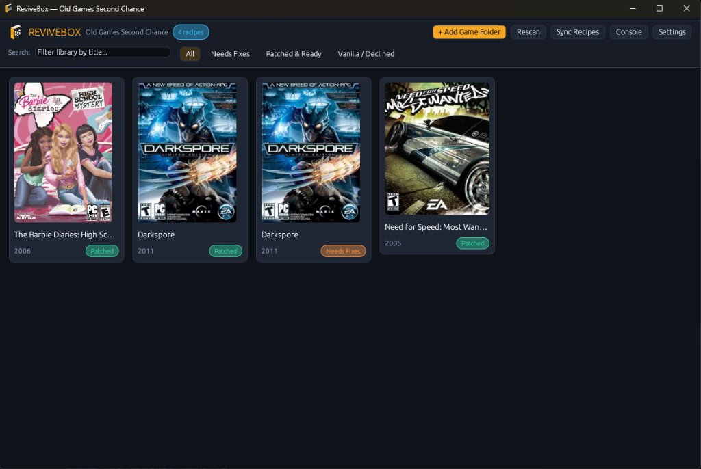

# ReviveBox

> **Old Games Second Chance**

An open-source, ultra-fast Windows desktop launcher and declarative compatibility engine designed to run legacy PC games (1995–2012) smoothly on Windows 10 and Windows 11 with one click.

<p align="center">
  
</p>

## Core Philosophy

- **Bring Your Own Game (BYOG):** Zero copyrighted game binaries, zero piracy cracks, and zero bypasses. Users point **ReviveBox** at legally owned local game installations (Retail CD/DVD, Steam, GOG, EA App, Ubisoft Connect, etc.). Executable fingerprinting identifies the exact release and applies verified open-source wrappers, community fixes, configuration tweaks, and Windows compatibility flags.
- **Zero Bloat & Native Speed:** Built in pure Rust with `egui / eframe` for `<500 ms` cold startup and minimal idle memory overhead.
- **Non-Destructive & Portable:** Originals are backed up content-addressed in `.ogsc_backup/` prior to patching, global Registry/Documents pollution is avoided (`HKCU`-scoped flags and `.ogsc_sandbox/` save redirection), and every fix group supports transactional rollback.

## Supported Games

| Game | Year | Required Version / Notes | Included Fixes | Recipe Status |
| :--- | :--- | :--- | :--- | :--- |
| **The Barbie Diaries: High School Mystery** | 2006 | Retail PC `v1.0` (`2006-09-21`, verified `ExactSha256`; optional 32-bit Flash 8–10 ActiveX for SWF v8 intro/minigames) | 6 surgical x86 NULL-guard `bsdiff` crash fixes, `eesettings.override.xml` windowed/60 Hz shadow/Flash bypass tuning, Win10/11 DPI + 2-core affinity, optional `dgVoodoo 2` | Verified (`Ready to Play`) |
| **Need for Speed: Most Wanted** | 2005 | Official `v1.3` (non-SafeDisc release or optical disc; EU/PAL verified `ExactSha256`) | ThirteenAG Widescreen Fix + 4K shadows, built-in XInput controller support & Xbox icons, portable `.ogsc_sandbox/saves`, Win10/11 DPI + 4-core affinity, optional `dgVoodoo 2` | Verified (`Ready to Play`) |
| **Darkspore** | 2011 | Steam Demo `v5.3.0.103` (verified `ExactSha256`) or Latest `v5.3.0.127` + VC++ Redistributable (`v5.3.0.15` DVD marked incompatible with ReCap) | Resurrection Capsule (`ReCap v0.7.2`) local server + automatic `RecapLauncher.exe` launch override, `ConfigManager.txt` modern GPU High-preset + 60 FPS cap (`bsdiff`), Win10/11 DPI + 4-core affinity, optional `dgVoodoo 2` | Verified (`Partially Playable` via ReCap) |
| **Tom Clancy's Splinter Cell: Pandora Tomorrow** | 2004 | Retail PC patched to `v1.31` | `dgVoodoo 2` Direct3D 8 shadow buffer fix, ThirteenAG Widescreen Fix, single-core RDTSC affinity | Template (Awaiting binary hash verification) |

## To-Do List & Roadmap

### Completed
- [x] Pure-Rust desktop GUI (`ReviveBox` via `egui`/`eframe`) and developer CLI (`ogsc`)
- [x] Transactional `.ogsc_backup/` journaling, content-addressed rollback, read-only file handling, and idempotent `bsdiff` patching
- [x] On-demand SHA-256-verified `dgVoodoo 2` and `DxWrapper` toolkit provisioning
- [x] Built-in **Debug Console** (pre-launch PE/DRM/DLL/ASI inspection, live `stdout`/`stderr`, Windows `NTSTATUS` exit-code decoder, and automatic Event Viewer `1000`/`1005` crash lookup)
- [x] **Version & Requirements** compatibility banners and `INCOMPATIBLE` build warnings in Game Details & Patch Advisor
- [x] Cover artwork loader (`cover_art_url`, SteamGridDB, and custom local covers) + GitHub remote recipe sync
- [x] Windows `os error 740` (`ShellExecuteExW` `"runas"`) elevation fallback & fix-conditional executable launch overrides

### Upcoming To-Do
- [ ] Verify real binary SHA-256 hashes for *Splinter Cell: Pandora Tomorrow (2004)* and *NFS: Most Wanted* US / Black Edition releases
- [ ] Add verified recipes for additional 1995–2012 PC classics (DirectX 7/8/9, Glide, and DOS/Win16 titles)
- [ ] On-demand provisioning for `DOSBox-X`, `86Box`, and `WineD3D` toolkits
- [ ] Debug Console enhancements: export log to `.txt`, tag/level filtering (`ERROR`/`WARN`), and one-click crash summary copy
- [ ] Windows `.exe` release packaging (embedded `.ico` resource, GitHub Actions CI, and automated release builds)
- [ ] Community recipe contribution guide (`CONTRIBUTING.md`) and GitHub PR strict validation workflow (`ogsc validate --strict`)
- [ ] Multi-language UI localization (English, Croatian/Bosnian/Serbian, etc.)

## Workspace Architecture

- `crates/ogsc-recipes` — Declarative `GameRecipe` schema (`required_game_version`, `incompatible_releases`, `fix_executable_overrides`), strict security/semantic validator, multi-file JSON database loader, and Draft 2020-12 JSON Schema generator.
- `crates/ogsc-scanner` — Multi-stage parallel directory scanner (`walkdir` + `rayon`), buffered streaming SHA-256 / partial SHA-256 / MD5 hasher, content-addressed transactional backup & rollback journal (`BackupManager`), and atomic local `library.json` persistence (`LibraryStore`).
- `crates/ogsc-wrappers` — Compatibility toolkit catalog (`ToolkitStore`) with verified on-demand HTTPS provisioning, deterministic CRLF config generators, dry-run wrapper planner, and transactional deployment for `dgVoodoo 2`, `DxWrapper`, `WineD3D`, `XInput Plus`, `DOSBox-X`, and `86Box`.
- `crates/ogsc-patcher` — Dry-run `plan_fixes` preview, structured `PatchEvent` progress/log stream, verified HTTPS streaming downloader (`ureq`), Zip-Slip-safe `.zip`/`.7z` extractor, idempotent `bsdiff` binary patcher, comment-preserving encoding-aware INI editor (`UTF-8` / `Windows-1252` / `UTF-16LE`), `HKCU` `AppCompatFlags\Layers` registry backend, CPU affinity / priority game launcher (`launch_game_captured`), and transactional `PatchEngine` with automatic per-fix rollback.
- `crates/ogsc-ui` — Native `egui / eframe` desktop launcher (`ogsc-launcher`) with async folder scanner, card grid + cover art cache, **Version & Requirements** banners, Game Details side panel, consent-driven Patch Advisor modal, live **Debug Console** drawer, and GitHub remote recipe sync.
- `crates/ogsc-cli` — Developer and diagnostic CLI (`validate`, `inspect`, `export-schema`, `hash`, `scan`, `library`, `backup`, `apply`, `launch`).
- `recipes/games/` — Versioned declarative JSON compatibility recipes (`barbie_diaries_high_school_mystery_2006.json`, `nfs_most_wanted_2005.json`, `darkspore_2011.json`, `splinter_cell_pandora_tomorrow_2004.json`) and binary `.bsdiff` patches under `recipes/games/patches/`.
- `recipes/schema/` — Auto-generated Draft 2020-12 JSON Schema (`game_recipe.schema.json`).

## Local Verification (Windows 10/11)

```powershell
# Launch the Desktop GUI
cargo run -p ogsc-ui

# Or run an optimized release binary
cargo run --release -p ogsc-ui

# Export/refresh JSON Schema
cargo run -p ogsc-cli -- export-schema --output recipes/schema/game_recipe.schema.json

# Format & lint
cargo fmt --all -- --check
cargo clippy --workspace --all-targets -- -D warnings

# Run all unit & integration tests across all crates
cargo test --workspace

# Validate and inspect recipes
cargo run -p ogsc-cli -- validate recipes/games
cargo run -p ogsc-cli -- validate --strict recipes/games/darkspore_2011.json
cargo run -p ogsc-cli -- inspect recipes/games/nfs_most_wanted_2005.json

# Scan, preview dry-run fixes, and preview launch command
cargo run -p ogsc-cli -- scan "C:\Games" --library library.json
cargo run -p ogsc-cli -- apply recipes/games/nfs_most_wanted_2005.json --game-root "C:\Games\NFS Most Wanted" --dry-run
cargo run -p ogsc-cli -- launch recipes/games/nfs_most_wanted_2005.json --game-root "C:\Games\NFS Most Wanted" --applied-fix win11_stability_tuning --dry-run
```
